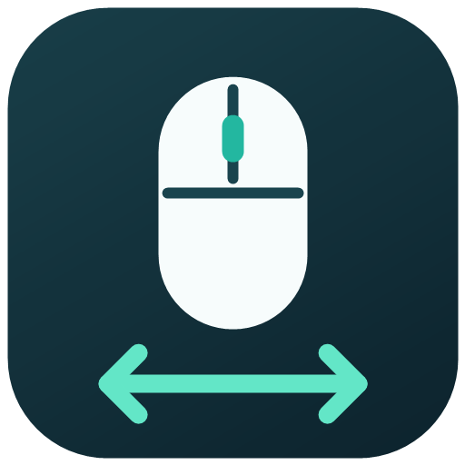
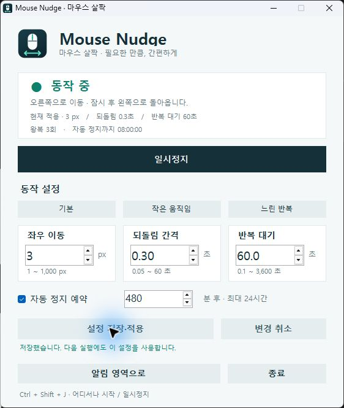

<p align="center"></p>

# Mouse Nudge · 마우스 살짝

A small, portable Windows mouse mover with adjustable distance and timing, a global hotkey, and an optional automatic-stop timer. The interface is in Korean.

마우스를 설정한 거리만큼 오른쪽으로 움직이고 되돌리는 작은 Windows 도구입니다. 한 화면에서 상태 확인, 시작·일시정지, 설정 변경을 할 수 있습니다.

**[최신 버전 다운로드](https://github.com/chammoru/mouse-nudge/releases/latest)** · [실행 파일](https://github.com/chammoru/mouse-nudge/releases/latest/download/MouseNudge.exe) · [변경 기록](CHANGELOG.md)



## 사용하기

1. 릴리스에서 `MouseNudge.exe`를 내려받아 쓰기 가능한 폴더에 저장합니다. ZIP에는 사용법과 아이콘, 소스도 포함되어 있습니다.
2. 실행하면 **3 px → 0.3초 후 되돌림 → 10초 대기**를 반복합니다. 저장한 설정이 있으면 그 값을 사용합니다.
3. 거리와 간격을 바꾼 뒤 **설정 저장·적용**을 누릅니다. 편집 중에도 상단의 **현재 적용**에는 실제로 사용하는 값이 표시됩니다.
4. **시작 / 일시정지** 버튼 또는 **Ctrl+Shift+J**로 조작합니다.

설치 프로그램과 관리자 권한은 필요하지 않습니다. Windows 10/11 및 .NET Framework 4.x를 사용합니다.

## 기능과 UX

| 기능 | 동작 |
| --- | --- |
| 상태를 먼저 확인 | 동작 상태, 다음 움직임, 실제 적용된 값, 왕복 횟수와 남은 시간을 상단에 표시 |
| 전역 단축키 | **Ctrl+Shift+J**로 시작·일시정지. 키를 길게 눌러도 반복 전환하지 않음 |
| 프리셋 | 기본 / 작은 움직임 / 느린 반복을 선택하고 저장·적용. 자동 정지 예약은 유지 |
| 편집 상태 구분 | 저장 전 변경사항을 표시하고 **변경 취소**로 적용 중인 값으로 복원 |
| 거리·간격 | 좌우 이동 1–1,000 px, 되돌림 0.05–60초, 반복 대기 0.1–3,600초 |
| 자동 정지 | 1–1,440분의 동작 시간 후 일시정지. 일시정지 중에는 남은 시간이 줄지 않음 |
| 알림 영역 | 창 열기 / 시작·일시정지 / 종료. 이미 실행 중이면 기존 창을 복원 |
| 설정 저장 | 실행 파일 옆 `MouseNudge.settings.xml`. 버전 1.1의 설정 파일도 읽음 |
| 명령줄 제어 | 숨긴 앱도 `--pause`, `--show`, `--quit`로 제어 |

Windows의 마우스 속도·가속 설정 및 화면 가장자리에서는 실제 이동 거리가 달라질 수 있습니다. 오른쪽으로 이동한 뒤 설정을 적용하거나 일시정지하면 이전 거리만큼 먼저 되돌립니다.

자동 정지의 분 수를 바꾸어 적용하면 새 시간으로 다시 계산합니다. 이동 거리·간격만 바꾸면 남은 시간은 유지합니다. 자동 정지 완료 후 **시작**을 누르면 새 세션을 시작합니다.

## 작업 표시줄과 다른 PC

- 실행한 뒤 작업 표시줄 아이콘을 우클릭하여 **작업 표시줄에 고정(Pin to taskbar)**을 선택하세요.
- 고정한 실행 파일을 옮겼다면 새 위치에서 다시 고정하세요.
- 업데이트할 때는 기존 버전을 종료한 뒤 새 파일을 실행하세요.
- 다른 PC로 설정까지 가져가려면 EXE와 `MouseNudge.settings.xml`을 함께 복사하세요.
- 잠금·연결 해제·절전 시 일시정지합니다. 돌아온 뒤 직접 시작하세요.
- 다른 프로그램이 단축키를 사용 중이면 안내가 표시됩니다. 창과 알림 영역의 버튼은 계속 사용할 수 있습니다.

## 명령줄

```powershell
.\MouseNudge.exe --paused  # 일시정지 상태로 실행
.\MouseNudge.exe --pause   # 실행 중인 앱을 일시정지
.\MouseNudge.exe --show    # 실행 중인 창 복원
.\MouseNudge.exe --quit    # 실행 중인 앱 종료
```

`--pause`, `--show`, `--quit`는 앱이 없으면 새 창을 띄우지 않고 종료 코드 2를 반환합니다. 접근 권한이 없으면 3을 반환합니다. 제어 명령은 같은 Windows 로그인 세션에서 사용합니다.

## 빌드와 검증

추가 SDK나 NuGet 패키지 없이 Windows에 포함된 .NET Framework C# 컴파일러를 사용합니다.

```powershell
.\src\build.ps1 -OutputDirectory .\dist
$check = Start-Process .\dist\MouseNudge.exe -ArgumentList '--self-test', 'result.txt' -Wait -PassThru
Get-Content .\result.txt
if ($check.ExitCode -ne 0) { throw 'Verification failed' }
```

자동 검증은 실제 커서를 움직이지 않고 이동 순서, 설정 변경, 저장·복원, 자동 정지와 인스턴스 제어를 검사합니다. UI를 검사할 때는 `-Preview`로 별도 빌드할 수 있습니다. Preview는 실제 입력을 보내지 않습니다.

## 개인정보와 제거

프로그램은 네트워크 요청, 텔레메트리, 전역 키보드 후크를 사용하지 않습니다. 전역 단축키는 Windows `RegisterHotKey`를 사용합니다. 설정은 EXE 옆 XML 파일에만 저장하며 시작 프로그램에 등록하지 않습니다.

종료한 뒤 EXE와 설정 파일을 삭제하면 제거됩니다.

## 참고한 프로젝트

기능과 UX 아이디어를 비교한 기록은 [BENCHMARK.md](BENCHMARK.md)에 있습니다. 외부 프로젝트의 소스나 자산을 복사하지 않았으며, 이 저장소의 기능은 직접 구현했습니다.

## License

[MIT](LICENSE)
